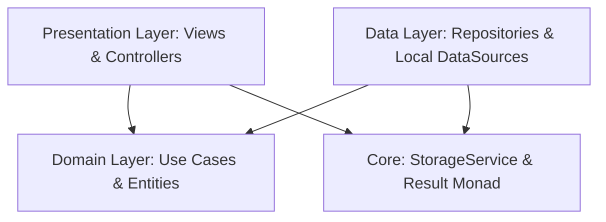

# Miquido — Gym & FitBot AI Flutter Application

[](https://flutter.dev)
[](https://pub.dev/packages/get)
[](https://pub.dev/packages/get_storage)
[](#-clean-architecture--software-engineering-principles)
[](https://flutter.dev)
[](https://flutter.dev)

A modern, production-grade Flutter Gym & Fitness AI Chatbot application crafted from the official [Miquido Gym Chatbot App Figma Community Design](https://www.figma.com/design/9hAHsqg5TmP3NFeG3Jz4ma/Miquido---Gym-Chatbot-App-Concept--Community-).

Engineered following **Clean Architecture**, **SOLID Principles**, **Software Design Patterns**, **Functional Error Handling (`Result<T>`)**, **Reactive State Management (GetX)**, and **Local Storage Persistence (GetStorage)**.

---

## 📱 Implemented Screens & User Experience

The application implements all core Figma designs plus expanded complementary screens to deliver a complete gym fitness experience:

| # | Screen | Route | Key Features & Figma Source |
|---|---|---|---|
| 1 | **Home Dashboard** | `AppRoutes.home` | Figma node `403:3051`. Upcoming workout card with custom vector runner illustration, period filter modal (Weekly, Monthly, Yearly), nearby gym clubs with distance & rating, and smooth cubic Bezier weekly activity chart with Wednesday peak indicator & tooltip. |
| 2 | **Statistics & Rings** | `AppRoutes.statistics` | Figma node `403:3246`. Interactive 7-day calendar strip with dynamic day selection, overview metric cards (Cal Burnt, Total Time, Exercises, Breaks), custom-painted triple concentric progress rings (Sleep 76%, Calories 52%, Steps 33%), and weekly calories bar chart. |
| 3 | **FitBot AI Chatbot** | `AppRoutes.chatbot` | Figma node `403:2913`. Sports AI concierge with active status, conversation bubble thread, quick-reply suggestion chips, facility recommendation cards, voice recording simulator with live timer and stop trigger, and direct booking modal. |
| 4 | **My Gym Bookings & QR Pass** | `AppRoutes.bookings` | Active passes & history tabs, pass details (facility, address, slot time, price), turnstile QR scan code (`MIQ-...`), and instant pass cancellation with live reactive updates. |
| 5 | **Live Workout Interval Runner** | `AppRoutes.workoutTracker` | Interval exercise runner with active countdown timer (45s–60s), Play/Pause control, automatic progression to next exercise, exercise list tracking, and celebratory completion dialog. |
| 6 | **Search & Explore Facilities** | `Navigation Index 1` | Real-time facility search powered by GetX `debounce` worker (300ms), horizontal category filter chips (All, Gym, SPA, Pool, CrossFit), detailed facility cards, and empty state handler. |
| 7 | **Notifications & Alerts** | `AppRoutes.notifications` | Push notification feed with unread indicators, categories (Booking, Workout, Reminder), time stamps, and "Mark All as Read" action. |
| 8 | **Facility Details & Slot Booking** | `AppRoutes.facilityDetail` | High-res header, amenity badges, price tags, operating hours, full address, and one-tap reservation button connected to FitBot. |
| 9 | **Profile & Daily Target Editor** | `Navigation Index 3` | Member account summary, streak counters, interactive bottom sheet with sliders to customize Sleep, Calorie, and Step targets with live sync to Statistics, plus cache reset utility. |

---

## 🏛️ Clean Architecture & Software Engineering Principles

The application is structured into four distinct layers adhering to the **Dependency Inversion Principle** and **Feature-First Clean Architecture**:



### Layer Responsibility

```
lib/
├── core/
│   ├── errors/                 # Domain Failure hierarchy (StorageFailure, ValidationFailure, NotFoundFailure)
│   ├── utils/                  # Functional Result<T> monad (when, fold, data, failure)
│   ├── widgets/                # Reusable UX widgets: ShimmerLoading, ErrorView, EmptyStateView
│   ├── storage/                # Storage interface (IStorageService) & GetStorage implementation
│   └── theme/                  # DM Sans typography, Figma color palette & AppTheme
├── features/
│   ├── home/
│   │   ├── domain/             # WorkoutEntity, ActivityPointEntity, IHomeRepository, GetHomeDataUseCase
│   │   ├── data/               # Models (WorkoutModel, ActivityPointModel), HomeLocalDataSource, HomeRepositoryImpl
│   │   └── presentation/       # HomeController, WorkoutTrackerController, HomeView, WorkoutTrackerView
│   ├── statistics/
│   │   ├── domain/             # UserMetricEntity, DayProgressEntity, IStatisticsRepository, GetUserMetricsUseCase
│   │   ├── data/               # Models, StatisticsLocalDataSource, StatisticsRepositoryImpl
│   │   └── presentation/       # StatisticsController, StatisticsView, ConcentricProgressRings, WeekCalendarStrip
│   ├── chatbot/
│   │   ├── domain/             # ChatMessageEntity, GymFacilityEntity, GymBookingEntity, IChatbotRepository, UseCases
│   │   ├── data/               # Models with JSON serialization, ChatbotLocalDataSource, ChatbotRepositoryImpl
│   │   └── presentation/       # ChatbotController, BookingsController, ChatbotView, BookingsView
│   ├── facilities/
│   │   └── presentation/       # FacilityDetailView
│   ├── notifications/
│   │   ├── domain/             # NotificationItemEntity
│   │   └── presentation/       # NotificationController, NotificationsView
│   └── navigation/
│       └── presentation/       # MainNavigationView, FloatingNavBar, SearchExploreView, ProfileView
└── routes/
    ├── app_routes.dart         # Type-safe string route constants
    └── app_pages.dart          # GetPage declarations with custom page transitions
```

---

## 💎 SOLID Principles Implementation

| Principle | Architectural Implementation in Code |
|---|---|
| **Single Responsibility (SRP)** | Every class has one reason to change. Use cases (`GetHomeDataUseCase`, `CreateGymBookingUseCase`, `GetUserMetricsUseCase`) encapsulate a single business action. Controllers manage UI state only; datasources handle raw storage I/O. |
| **Open/Closed (OCP)** | Storage and data retrieval depend on contracts (`IStorageService`, `IHomeRepository`, `IChatbotRepository`). Adding a remote REST/GraphQL backend requires writing an implementation of the interface without altering domain use cases or presentation controllers. |
| **Liskov Substitution (LSP)** | `StorageService` implements `IStorageService`. In test suites, `MockStorageService` substitutes it cleanly without side effects or altered invariants. |
| **Interface Segregation (ISP)** | Interfaces are compact and domain-focused. Distinct use cases exist for specific operations (`GetUserBookingsUseCase`, `CancelBookingUseCase`, `CreateGymBookingUseCase`) rather than monolithic God-interfaces. |
| **Dependency Inversion (DIP)** | High-level business logic does not depend on low-level storage details. In `NavigationBinding`, interfaces are bound via `Get.lazyPut<IHomeRepository>(() => HomeRepositoryImpl(...))`. |

---

## 🎨 Design Patterns Implemented

1. **Repository Pattern:** Separates business domain from data persistence (`IHomeRepository`, `IStatisticsRepository`, `IChatbotRepository`).
2. **Use Case Pattern (Interactor):** Encapsulates business rules and orchestrates data flow into single-purpose invokable classes.
3. **Result Monad Pattern (`Result<T>`):** Functional error handling returning either `Result.success(data)` or `Result.failure(failure)`, eliminating uncaught runtime exceptions.
4. **Observer / Reactive Pattern:** GetX `RxList`, `RxBool`, `RxString`, and `.obs` primitives enabling precise micro-updates without full widget-tree rebuilding.
5. **Debounce Pattern:** `debounce(searchQuery, ...)` in `SearchExploreController` prevents excessive queries during rapid user typing.
6. **Factory / DTO Pattern:** Separate `Model` classes with `fromJson()` / `toJson()` that map cleanly into immutable pure Dart `Entities`.

---

## 🌟 Top-Tier UX Highlights

- **Custom Vector Graphics & Painters:**
  - `ConcentricProgressRings`: Hand-crafted custom painter rendering triple circular arcs with smooth stroke caps and glow endpoints.
  - `ActivitiesChart`: Cubic Bezier spline with gradient shader and an interactive Wednesday peak indicator (`3h 14min`).
  - `WorkoutCard`: Custom vector treadmill platform and runner silhouette.
  - `FloatingNavBar`: Elevated floating pill bottom bar matching Figma specifications with active indicator dots.
- **Lazy Loading & Scroll Pagination:**
  - **Explore Facilities:** Infinite scroll pagination via `ScrollController` listener, batching items in 4-item pages with live bottom loading spinners and empty search filters.
  - **My Bookings:** Lazy pagination on history and active passes list with threshold triggers.
- **Micro-Interactions, Animations & Lottie:**
  - **Lottie Vector Animations:** High-performance procedural Bodymovin celebration confetti burst on workout completion (`assets/animations/celebration.json`) and gentle floating disc pulse on empty states (`assets/animations/empty.json`).
  - **Declarative Staggered Animations (`flutter_animate`):** Smooth entrance fades, vertical translations (`slideY`), scale bounces, and interval countdown ring pulses across `HomeView`, `StatisticsView`, `ChatbotView`, and `WorkoutTrackerView`.
- **Zero Hardcoded Colors & Centralized Tokens:**
  - Centralized palette in `AppTheme`: all status colors (`successGreen`, `errorRed`, `warningAmber`), backgrounds, borders, text shades, and vector illustration tokens.
  - Zero hardcoded `Color(0x...)` across presentation views and core widgets.
- **Centralized Branded Snackbar System (`AppSnackbar`):**
  - Type-safe snackbar alerts for `success`, `error`, `warning`, and `info` with distinct status iconography, rounded card borders, soft drop shadows, and retry actions.
- **Micro-Interactions & States:**
  - **Shimmer Skeleton Loading:** Smooth animated gradients displayed during data acquisition.
  - **Standardized Error Views:** Actionable retry buttons and informative failure messages with shake animation.
  - **Standardized Empty States:** Engaging Lottie animation, clear typography, and navigation triggers.
  - **Audio Recording Feedback:** Pulse timer banner and one-tap voice query simulation.
  - **Turnstile QR Pass Generation:** Digital access pass format for seamless gym check-in.

---

## 🧪 Test Suite & Code Quality

The project features comprehensive automated tests verifying domain use cases, repository operations, local storage persistence, state machines, and widget smoke tests:

```bash
flutter test
```

### Test Coverage Summary:
- `test/unit/bookings_usecases_test.dart`:
  - `GetUserBookingsUseCase` returns initial seed passes.
  - `CreateGymBookingUseCase` produces valid bookings with turnstile QR codes (`MIQ-...`).
  - `CancelBookingUseCase` transitions pass state to cancelled and persists.
- `test/unit/chatbot_repository_test.dart`:
  - Loads Figma mock initial conversation history.
  - Generates contextual FitBot recommendations.
  - Persists bookings into storage.
- `test/unit/statistics_usecase_test.dart`:
  - Validates metric aggregates (Cal Burnt, Total Time, Exercises, Breaks).
  - Validates concentric ring progress percentages for Sleep, Calories, and Steps.
- `test/unit/workout_tracker_test.dart`:
  - Verifies interval timer toggling (start/pause).
  - Exercises progression through workouts and triggers completion state.
- `test/widget_test.dart`:
  - Smoke test validating dependency injection, root navigation, and initial screen rendering.

```bash
flutter analyze
# Analyzing Miquido...
# No issues found! (ran in 3.2s)
```

---

## 🚀 Getting Started

### Prerequisites
- **Flutter SDK:** `>=3.13.2`
- **Dart SDK:** `>=3.13.2`

### Setup Steps

1. **Clone the repository:**
   ```bash
   git clone https://github.com/jihanurrahman33/Miquido-GYM-Chatbot-App.git
   cd Miquido-GYM-Chatbot-App
   ```

2. **Fetch dependencies:**
   ```bash
   flutter pub get
   ```

3. **Run code analysis:**
   ```bash
   flutter analyze
   ```

4. **Execute all automated tests:**
   ```bash
   flutter test
   ```

5. **Run the application:**
   ```bash
   # Run on connected iOS Simulator, Android Emulator, macOS Desktop, or Chrome
   flutter run
   ```

---

## 📄 License
This project is open-source and released under the [MIT License](LICENSE).
